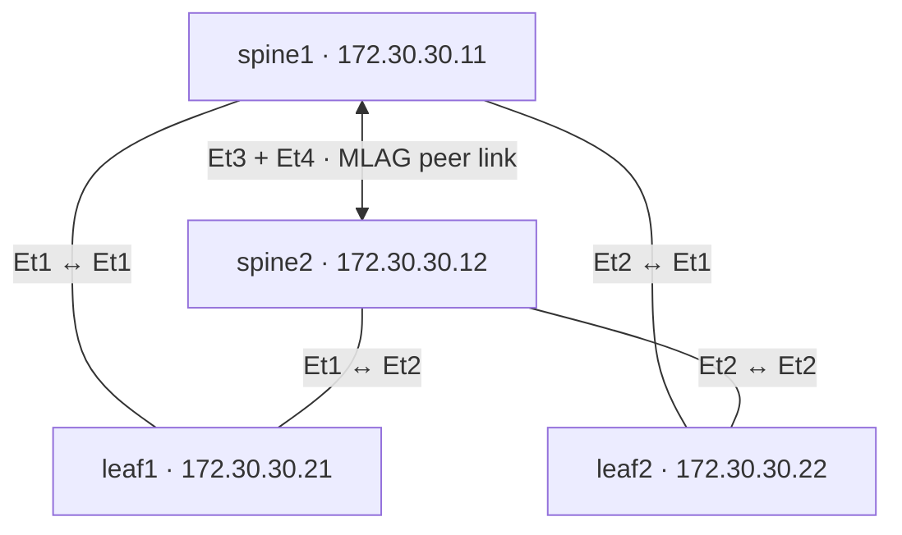

# Digital Twin

A four-switch L2 leaf-spine lab using **Arista AVD 6.5.0** and its native
Containerlab digital twin generator. The cEOS image is **`arista/ceos:latest`**.

The repository contains the input model and build playbooks. Dependencies,
generated artifacts, and containers have not been installed, built, or launched.

## Topology



- Two L2 spines form one MLAG pair. Ethernet3 and Ethernet4 form peer-link
  Port-Channel1000, with a peer IP pool of `10.255.255.0/30`.
- Each standalone L2 leaf has one LACP port-channel across both spines.
- VLAN 10 (`USERS`) and VLAN 20 (`SERVERS`) are carried across the fabric.
- MSTP priorities are 4096 on the spines and 16384 on the leaves.
- Management1 uses the MGMT VRF and subnet `172.30.30.0/24`, gateway `.1`.
- This is a pure L2 fabric: tenant gateways, routing, and traffic-generator
  endpoints are not included. AVD also generates the MLAG control SVI.

| Link | End A | End B |
| --- | --- | --- |
| Leaf 1 uplink A | leaf1 Ethernet1 | spine1 Ethernet1 |
| Leaf 1 uplink B | leaf1 Ethernet2 | spine2 Ethernet1 |
| Leaf 2 uplink A | leaf2 Ethernet1 | spine1 Ethernet2 |
| Leaf 2 uplink B | leaf2 Ethernet2 | spine2 Ethernet2 |
| MLAG peer link A | spine1 Ethernet3 | spine2 Ethernet3 |
| MLAG peer link B | spine1 Ethernet4 | spine2 Ethernet4 |

## Prerequisites

Open this repository in its dev container, which selects the AVD 6.5.0 image
with Python 3.13. Rebuild the container after changing its image version.
The Makefile uses `python3`, `ansible-playbook`, and `ansible-galaxy` from the
container's PATH. Both PyAVD and the Ansible collection are pinned to 6.5.0.

Launching the lab requires a **Linux Containerlab host**, Docker, and a cEOS-lab
image compatible with the host architecture. On macOS, you can generate the
files locally, then copy the repository to a Linux VM or server for deployment.
Native macOS deployment is not the workflow described here.

The lab login is **`admin` with no password**, with privilege 15. The model
allows passwordless local authentication. Use an isolated lab
network; choose another management subnet if `172.30.30.0/24` overlaps your host.
AVD 6.5's Containerlab feature is PREVIEW and uses the fixed Docker management
network name `custom_mgmt`; use one generated twin at a time on the host.

## 1. Open the dev container

Run commands from the repository root, keeping the directory name quoted:

```bash
ansible-galaxy collection list arista.avd
python3 -c 'import pyavd; print(pyavd.__version__)'
```

Both should report 6.5.0. If the container already supplies the dependencies,
continue directly to `make twin`. If dependencies are missing, `make setup`
installs Python dependencies into the container's current Python environment
and collections into `./collections`. No virtual environment is created.
The Ansible configuration also retains access to collections installed in the
container's standard locations.

## 2. Generate the digital twin

```bash
make twin
```

This runs the AVD roles locally without connecting to switches. The playbook
enables `avd_digital_twin_mode: true`. The model already contains:

```yaml
digital_twin:
  environment: containerlab
  fabric: {}
  use_default_interfaces_of_digital_twin_platform: true

_containerlab_image: arista/ceos:latest
```

`digital_twin.fabric: {}` is required by the AVD 6.5 schema for this environment.
`_containerlab_image` is a repository helper, not a native AVD field. AVD 6.5
hard-codes `arista/ceos:latest` in its generated topology; the final playbook task
replaces it with the selected image on every build. To override for one build:

```bash
ansible-playbook build-digital-twin.yml -e '_containerlab_image=arista/ceos:latest'
```

Expected outputs:

```text
digital_twin/
├── DIGITAL_TWIN-topology.clab.yml
├── interface_mapping.json
├── intended/
│   ├── configs/              # Four EOS startup configurations
│   └── structured_configs/   # Four per-device YAML configurations
└── documentation/
    ├── devices/
    └── fabric/
```

Keep the generated directory layout intact: the topology references
`intended/configs/<hostname>.cfg` and `interface_mapping.json` relative to itself.
The generated interface mapping translates Linux `ethN` into EOS `EthernetN`.

Optional: run `make build` to produce regular configurations under `intended/`
and `documentation/`, separate from the digital twin artifacts.

## 3. Prepare the cEOS image on the Linux host

If `arista/ceos:latest` is already present in Docker, skip the import:

```bash
sudo docker image inspect arista/ceos:latest
```

Otherwise, obtain your cEOS-lab archive from Arista and import it using the
correct path to your downloaded archive:

```bash
sudo docker import /path/to/cEOS-lab.tar.xz arista/ceos:latest
```

Here `arista/ceos` is the Docker image repository and `latest` is its tag.
If your image is instead named `ceos:latest`, set `_containerlab_image` to that
exact name in `group_vars/FABRIC.yml` and rerun `make twin`.

If you built in a dev container on your Mac, copy the entire generated
`digital_twin/` directory to the Linux host. Deploying generated artifacts alone
needs Docker, Containerlab, and the cEOS image. Rebuilding on another host needs
the same AVD 6.5 dependencies or dev container.

## 4. Launch and access the lab

On the Linux host, from the repository root:

```bash
make deploy
make inspect
```

Or deploy directly if you copied only the generated artifacts:

```bash
sudo containerlab deploy --topo digital_twin/DIGITAL_TWIN-topology.clab.yml
```

The generated topology uses `prefix: ''`, so container names match the inventory
hostnames. Open a console or connect over the host's management bridge:

```bash
sudo docker exec -it spine1 Cli
sudo docker exec -it leaf1 Cli
ssh admin@172.30.30.11
```

No login password is configured. If accessing from another computer, use a console
through the Linux host or provide routing to its Docker management network.

Allow the switches to finish booting. cEOS MLAG defaults include a 300-second
reload delay, so forwarding can take several minutes to settle.

## 5. Check the fabric

On each spine:

```text
show mlag
show mlag interfaces
show port-channel summary
show lldp neighbors
show vlan
show spanning-tree
```

Expect the MLAG peer to become active and the peer link to come up. Each spine
should discover both leaves and the other spine. MLAG client port-channels
should become active once the leaves boot and LACP converges.

On each leaf:

```text
show port-channel summary
show interfaces trunk
show lldp neighbors
show vlan
show spanning-tree
```

Expect both uplinks to bundle into the same port-channel, both spines in LLDP,
and VLANs 10 and 20 allowed on the trunk. The generated device documentation
lists the actual port-channel numbers and interface configuration.

These checks establish fabric adjacency and L2 control-plane state. End-to-end
user traffic needs attached test endpoints, which this four-switch lab does
not include. Management reachability alone does not test VLAN forwarding.

## 6. Change or stop the lab

Edit `group_vars/FABRIC.yml` for VLANs, credentials, and the image;
`group_vars/SPINES.yml` for the MLAG pair; and `group_vars/LEAVES.yml` for leaves
and uplinks. When changing management addresses, update both the node `mgmt_ip`
and inventory `ansible_host`, plus `mgmt_gateway` if changing the subnet.
All four management addresses must stay in a single IPv4 subnet.

To apply a changed model, destroy the running lab first, regenerate the files,
and deploy it again:

```bash
make destroy
make twin
make deploy
```

`make destroy` removes the containers and Containerlab runtime directory.
Keep desired changes in the YAML model: startup configs are enforced on deploy,
and rebuilding overwrites generated files.

## Files and references

| File | Purpose |
| --- | --- |
| `inventory.yml` | Four switches and their inventory groups |
| `group_vars/FABRIC.yml` | VLANs, management, credentials, digital twin settings |
| `group_vars/SPINES.yml` | Spine MLAG pair |
| `group_vars/LEAVES.yml` | Standalone leaves and aligned uplink mappings |
| `build-digital-twin.yml` | Generate native twin artifacts and select the image |
| `build.yml` | Generate separate regular artifacts |
| `requirements.txt`, `requirements.yml` | Version-matched Python and collection dependencies |

Sources used to prepare the model, all matched to AVD 6.5.0:

- [Official L2LS example](https://github.com/aristanetworks/avd/tree/v6.5.0/ansible_collections/arista/avd/examples/l2ls-fabric).
- [Containerlab digital twin documentation](https://avd.arista.com/6.5/ansible_collections/arista/avd/roles/eos_designs/docs/data-models.html#containerlab-digital-twin), including its preview limitations.
- [Digital twin schema](https://github.com/aristanetworks/avd/blob/v6.5.0/python-avd/pyavd/_eos_designs/schema/schema_fragments/digital_twin.schema.yml).
- [Containerlab generator](https://github.com/aristanetworks/avd/blob/v6.5.0/python-avd/pyavd/get_fabric_documentation.py#L192), including the fixed image name.
- [AVD installation requirements](https://avd.arista.com/6.5/docs/installation/collection-installation.html).

Source reference commit: `6867159b26356ca5a03e267bf9f8db01ff862b14`.
The model was prepared from the official schemas, implementation, and example;
no Ansible build, live deployment, or runtime verification was performed here.
